# The SVG framework, end to end

This is the whole flow — style decision, sourcing, drafting, the lint/render/look loop, population judging, the multi-agent forge, and finalize/promote — illustrated at every stage with the framework's own artifacts. Nothing here is a mock-up: the forge intermediates in [forge-run/](forge-run/) are the untouched outputs of a real `svg-forge` run (critic quotes below are verbatim from that run's transcripts), the files in [iterations/](iterations/) are byte-faithful reconstructions of the hand-loop versions as originally written, and everything in [variants/](variants/) regenerates deterministically from the commands at the bottom.

## The pipeline at a glance

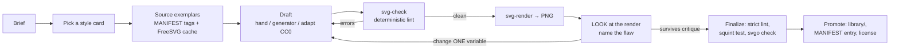

The loop in the middle is the entire trick: a model writing SVG is writing with its eyes closed, so every write gets linted (machine-checkable problems never reach vision) and rasterized (composition problems get *seen*, named, and fixed one variable at a time). The [svg-art skill](../../.claude/skills/svg-art/SKILL.md) holds the critique vocabulary; the `PostToolUse` hook enforces the loop on every `.svg` write; the [`svg-forge` workflow](../../.claude/workflows/svg-forge.js) runs the same loop multi-agent.

## Output options

One framework, many kinds of output — every cell links a real committed file:

| Option | Example | Produced by |
| --- | --- | --- |
| 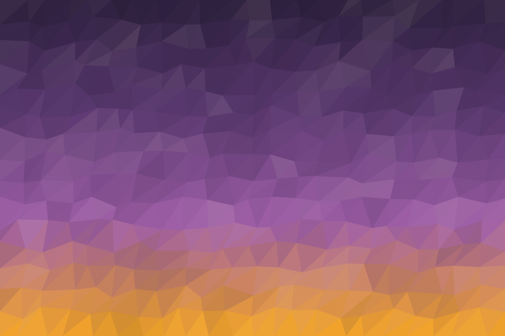 | Preview banner, 1536×1024 | The engine's `local` provider template (`banner-seed.py --slug hello-world`) |
| 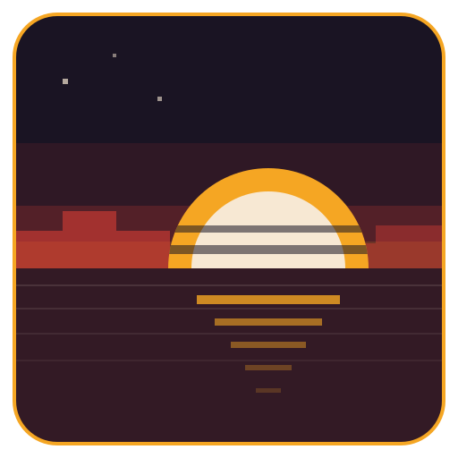 | Flat-geometric badge | Hand loop, [style card](../../tools/svg/library/styles/flat-geometric.md) |
|  | App-icon emblem | `svg-forge` multi-agent run (walkthrough below) |
|  | Atmospheric banner | Hand loop, [organic-atmos](../../tools/svg/library/styles/organic-atmos.md) |
|  | Night scene, `<defs>`+`<use>` motif | Hand loop (iteration story below) |
| 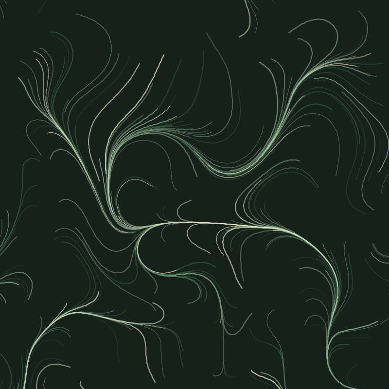 | Generative field | `flowfield.py`, seed-swept |
| 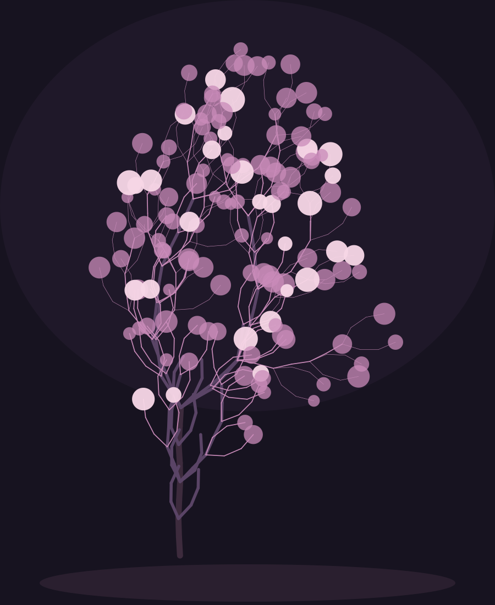 | Recursive botanical | `lsystem.py` (turtle L-system, depth-shaded, 4 species × 4 palettes) |
|  | Faceted low-poly field | `lowpoly.py` (jittered triangle grid, value-noise shading, sun glow) |
| 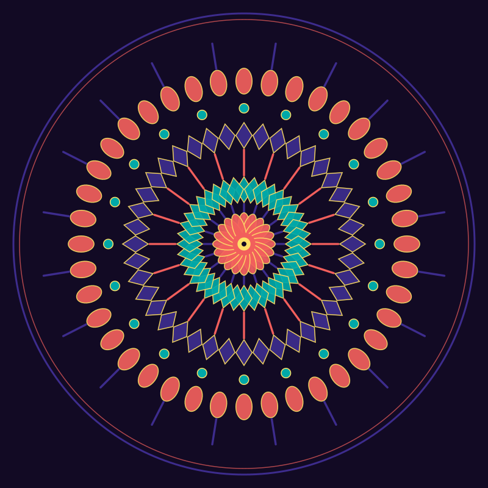 | Radial-symmetry mandala | `mandala.py` (N-fold concentric bands via `<use>` rotation) |
|  | Composed scene | `starmap.py` — MIT library icons over a generated starfield + low-poly hills |
| 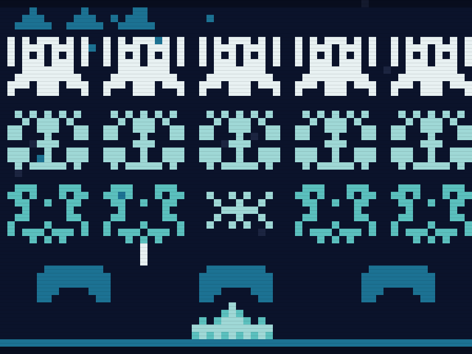 | Pixel-art game scene | `pixelkit.py` + `invaders.py` (procedural sprites) |
| 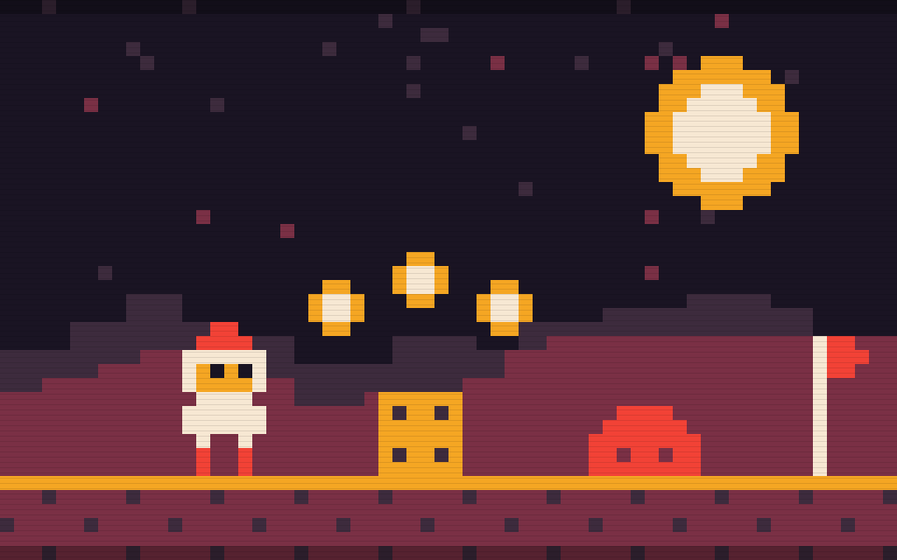 | Pixel-art platformer | `pixelkit.py` + `pixelquest.py` (ASCII sprites) |
|  | Mono-line icon sheet | [mono-line card](../../tools/svg/library/styles/mono-line.md) mini exemplar |
|  | Engraved plate shading | [engraved-hatch card](../../tools/svg/library/styles/engraved-hatch.md) mini exemplar |
|  | Isometric exploded diagram | [isometric-tech card](../../tools/svg/library/styles/isometric-tech.md) mini exemplar |
|  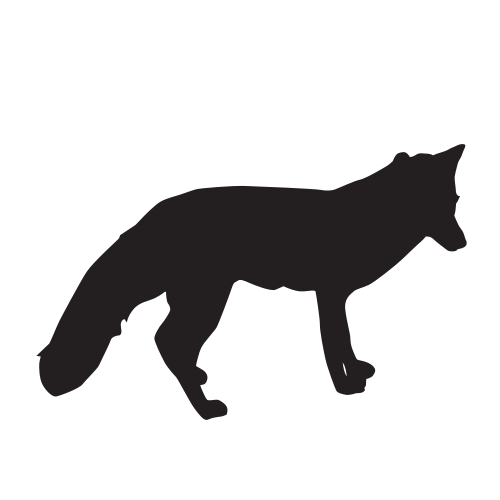 | Reused external art | License-vetted [library](../../tools/svg/library/README.md) + FreeSVG CC0 sourcing |

## Advanced generator gallery

Each generator is one algorithm with knobs; the same code re-skins across palettes and seeds, and every frame below was rendered and read before it was kept. The house rule holds — anything with repetition math (recursion, tiling, radial symmetry, triangulation) is a generator, never hand-authored path data.

**`lsystem.py`** — a recursive turtle over an L-system string, branches depth-shaded thick-dark-trunk → thin-bright-twig, blooms dropped at growth tips. One `tree` ruleset, three palettes:

| verdant | sakura | autumn |
| --- | --- | --- |
| 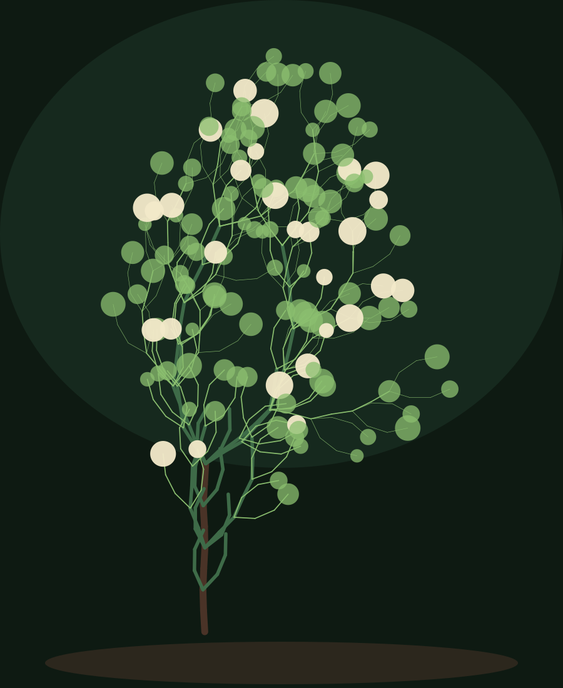 |  | 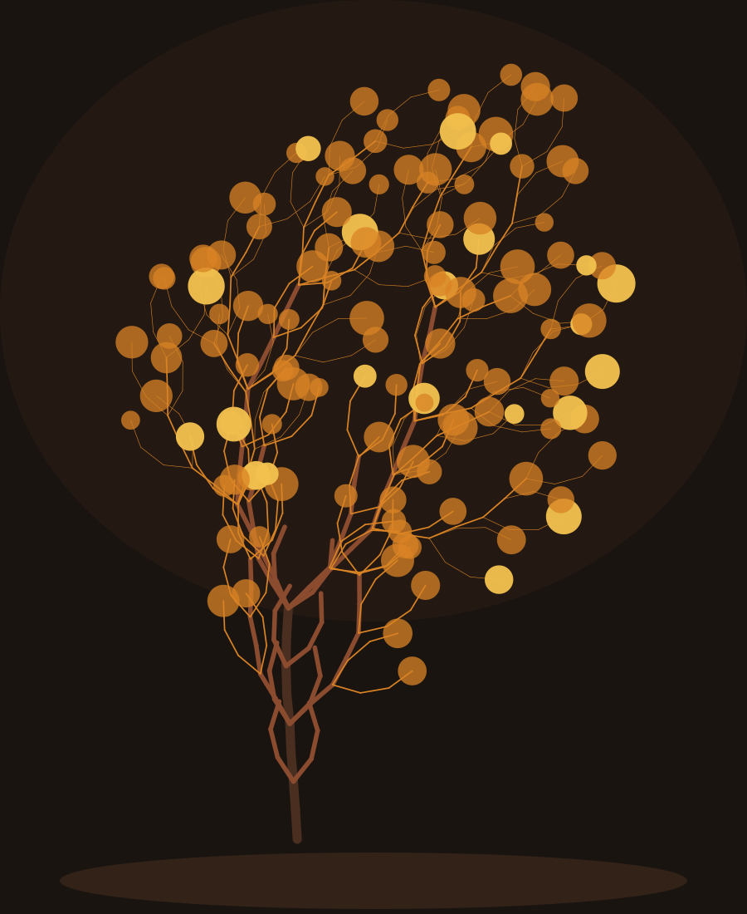 |

**`lowpoly.py`** and **`mandala.py`** — a jittered Delaunay-ish triangle field with value-noise facet shading, and N-fold concentric motif bands:

| low-poly dusk | low-poly cyanic | mandala jewel | mandala ocean |
| --- | --- | --- | --- |
| 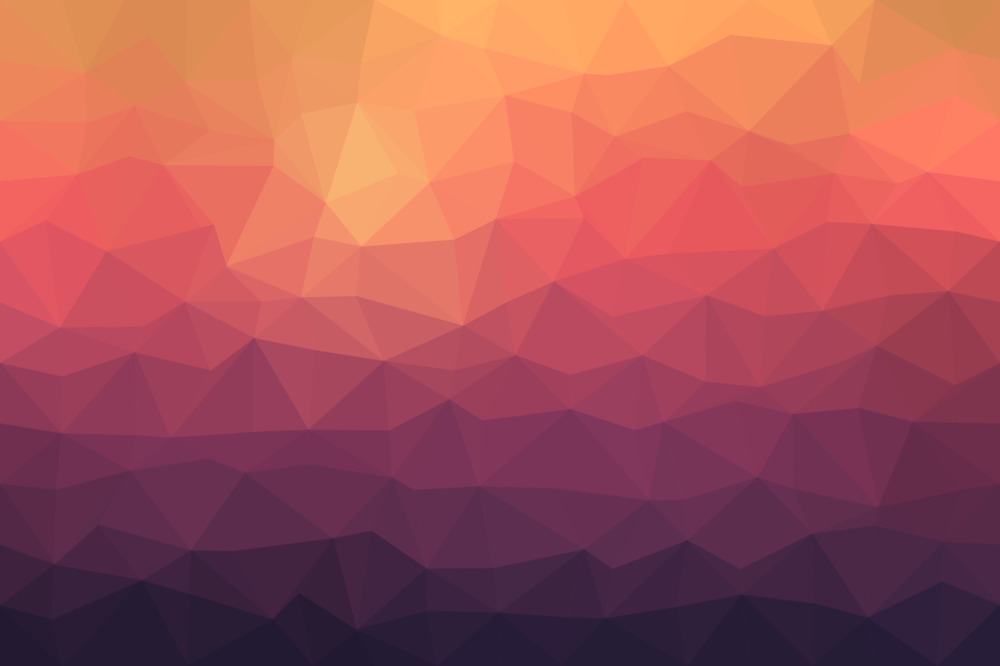 |  |  | 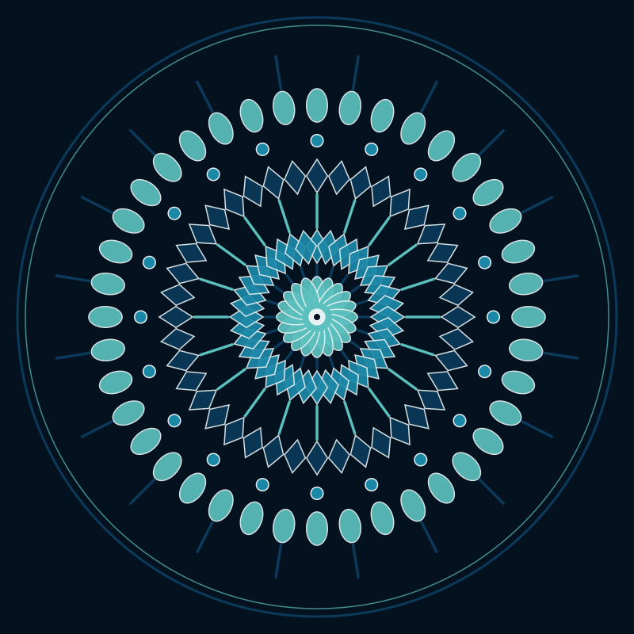 |

**`starmap.py`** — the composition path: MIT-licensed library icons (lucide rocket, tabler planet, feather star/moon) inlined and recolored over a generated starfield, glowing moon, and low-poly hills. This is how "gather content and create" works when the API catalog or the local library already has the pieces:


## Stage 0 — pick a style

Every request starts by matching the brief against a [style card](../../tools/svg/library/styles/): each card is a set of *testable* constraints (grid, palette roles, stroke rules), style-specific critique checks, and a seed recipe. Each ships with a strict-lint mini exemplar:

| retro-pixel | flat-geometric | mono-line |
| --- | --- | --- |
| 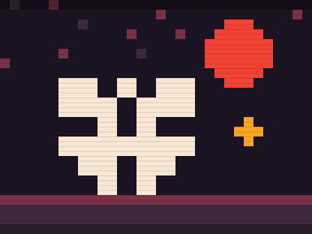 |  |  |

| engraved-hatch | isometric-tech | organic-atmos |
| --- | --- | --- |
|  |  | 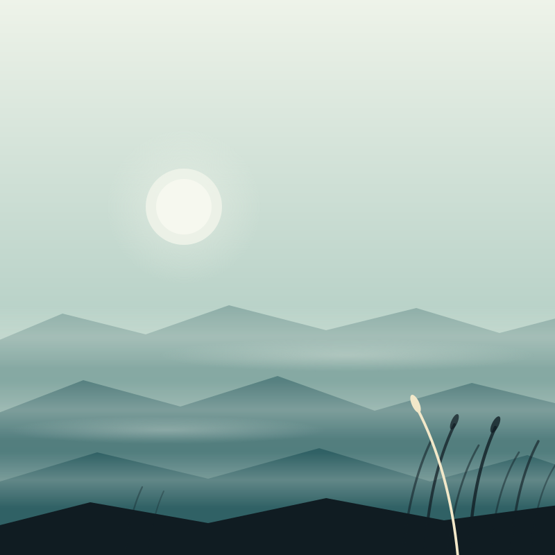 |

## Stage 1 — source before you draw

The second question is always "does good art already exist?" — [`MANIFEST.json`](../../tools/svg/library/MANIFEST.json) is tag-searchable across 55+ entries (icons, emoji, illustrations, first-party pieces), and [`freesvg.py`](../../tools/svg/freesvg.py) reaches FreeSVG's CC0 catalog cache-first so repeat lookups cost zero API calls:

```bash
grep -l '"rocket"' tools/svg/library/MANIFEST.json          # tag search, no tooling needed
python3 tools/svg/freesvg.py search "rocket"                 # CC0 catalog, cached 7 days
python3 tools/svg/freesvg.py fetch 12345                     # into the immutable file cache
```

    

Every external file carries provenance and license in the manifest; MIT/ISC/CC0 sources are safe to modify, share-alike sources are for as-is use ([the rules](../../tools/svg/library/README.md#licensing-rules)).

## Stage 2 — draft

Three entry points, in order of preference: adapt a sourced exemplar; run a parametric generator (house rule: anything with tiling, spirals, packing, or repetition gets a generator, never hand-authored path soup); or start from the style card's seed recipe.

```bash
python3 tools/svg/banner-seed.py --slug my-post --out draft.svg      # the engine's own template
python3 tools/svg/examples/flowfield.py --seed 5 --palette moss ...  # generative field
python3 tools/svg/examples/invaders.py --seed 3 ...                  # procedural pixel scene
python3 tools/svg/examples/pixelquest.py --seed 7 ...                # ASCII-sprite pixel scene
```

## Stage 3 — the deterministic gate

Everything checkable without eyes is checked without eyes. `svg-check.py` catches structural problems before any token is spent on vision — and the `PostToolUse` hook feeds failures straight back as exit-2 errors:

```text
$ python3 tools/svg/svg-check.py bad.svg
WARN  no <title> as first child (screen readers, and it shows as a tooltip)
WARN  missing role="img" on root
ERROR no viewBox on root — the art will not scale. Add viewBox="0 0 W H".
ERROR reference(s) to missing id(s): nope — gradient or clipPath will silently render as black/none
```

## Stage 4 — render and look

The hook rasterizes every clean `.svg` write and hands the PNG path back: *"Read the PNG now and critique the composition before making further edits."* The first grading axis is always the squint test — social cards and icon grids show art small, so the same file is judged at full size **and** at 120px:

| Full size | 120px squint test |
| --- | --- |
|  |  |

If the silhouette is mush at thumbnail size, nothing downstream matters.

## Stage 5 — name the flaw, change one variable

The hand loop, illustrated with the actual iterations. The rule: say what is wrong *out loud* before touching the file, then change one thing.

### Dawn badge: v1 → final

| v1 | final |
| --- | --- |
| 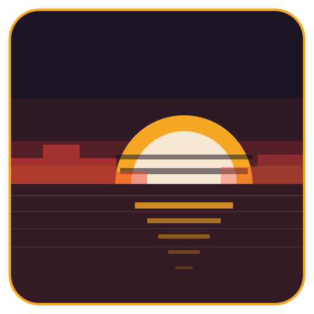 |  |

Named flaws in v1, each visible in the render and invisible in the code: the scanline bars overhang the sun's edge and read as floating sticks (fix: clip them to the sun disc); the right hill overlaps the sun at 0.35 opacity leaving pink smudges (fix: draw hills *behind* the sun); the top half is dead ink (fix: three pixel-stars).

### Constellation: v1 → v2 → final

| v1 | v2 — the fix that backfired | final |
| --- | --- | --- |
|  |  |  |

v1's moon glow was a flat translucent circle — flagged as a "conspicuous dark plate". v2 softened it to a radial gradient, which *exposed the real defect*: the crescent was faked with a background-colored stamp circle, and against the gradient it renders as an eclipse ball. The final version replaces the stamp with a true two-arc crescent path. That is the loop working as designed: each render names the next flaw, and some fixes only become visible after the previous one lands.

## Stage 6 — judge populations, not one lucky seed

For generative work a single output proves nothing. Sweep seeds, then pick:

| seed 2 — rejected | seed 5 — winner | seed 9 — rejected |
| --- | --- | --- |
| 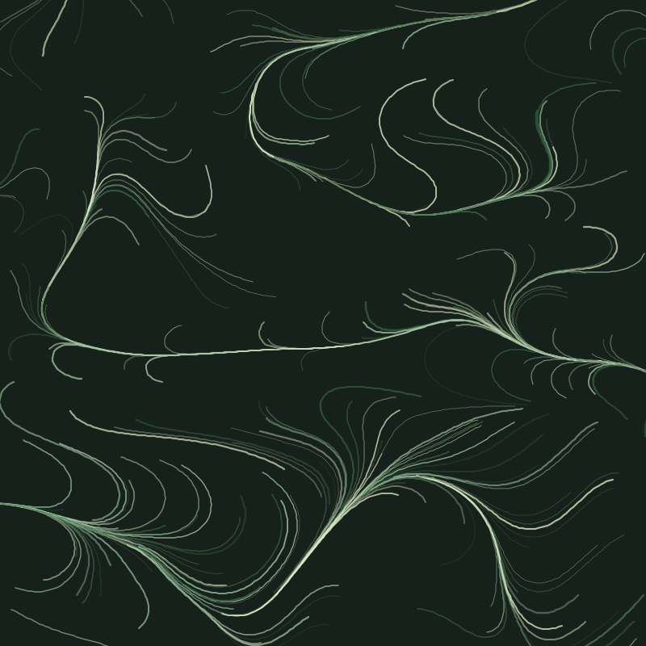 |  | 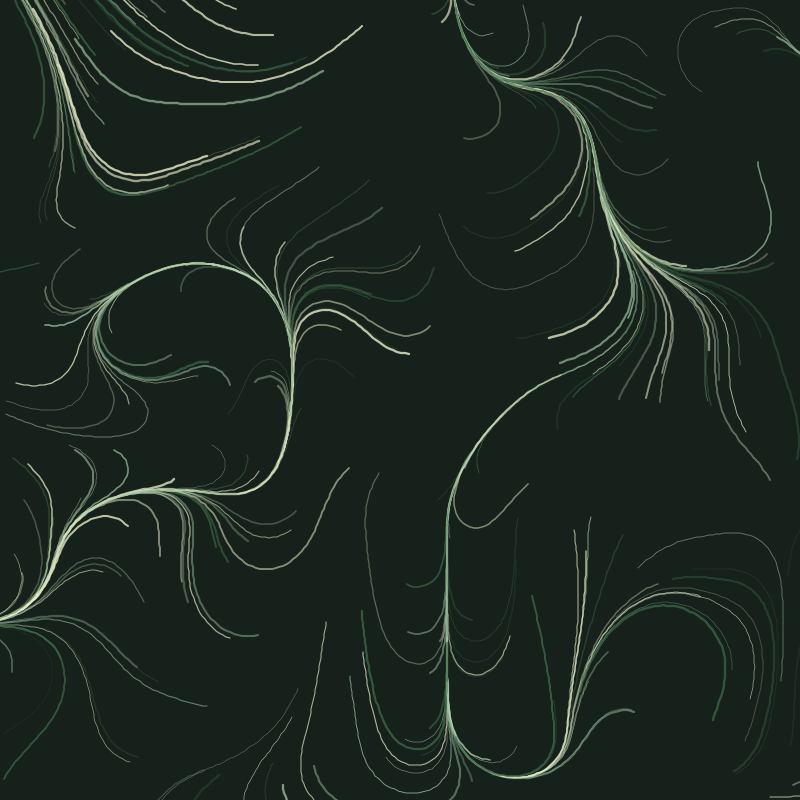 |

Verdicts from the session: seed 2 is even noise with no subject; seed 9 has two competing focal centers; seed 5 wins on its single feathered plume. The same discipline applies to palettes — a template change must improve the *population*:

| invaders: cyanic | magma | dusk |
| --- | --- | --- |
|  | 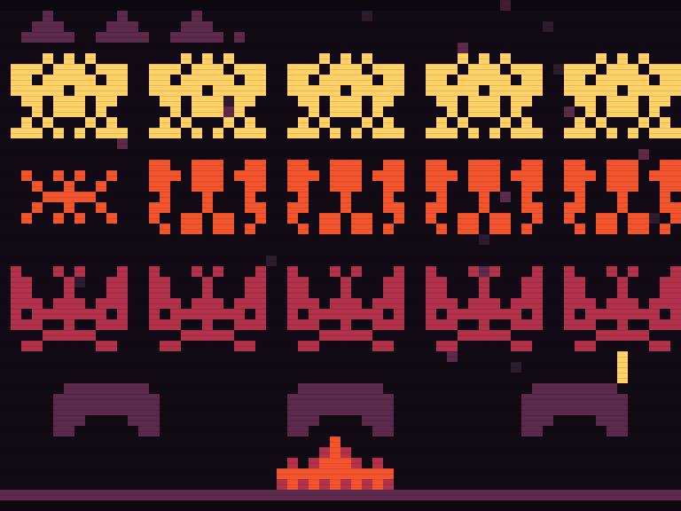 | 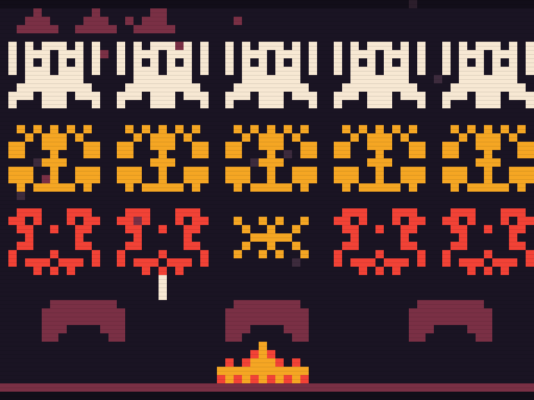 |

| pixel-quest: dusk | cyanic | moss |
| --- | --- | --- |
|  | 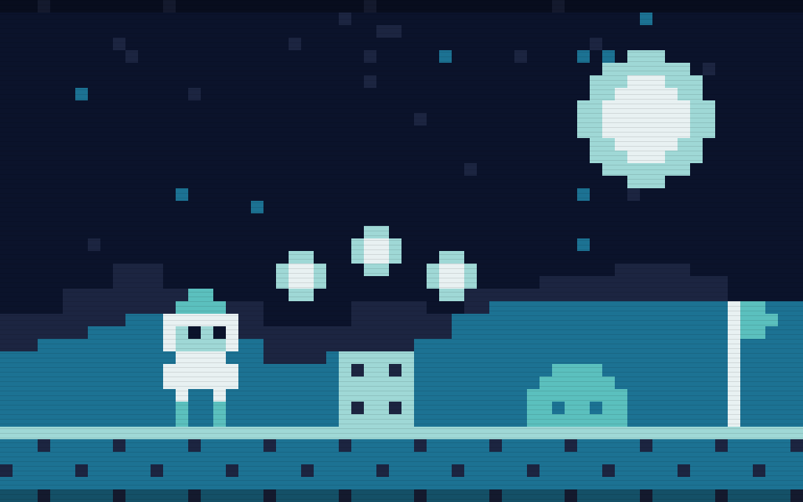 | 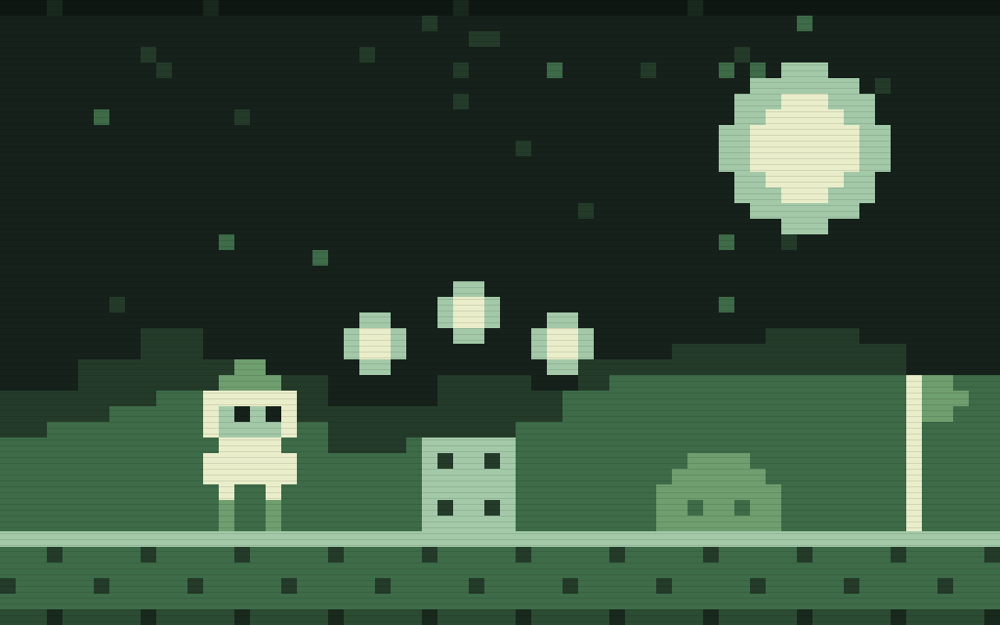 |

## Stage 7 — the multi-agent loop: a real `svg-forge` run

Brief: *"A space-explorer emblem: a small rocket arcing over a ringed planet, starfield behind, suitable as a 512×512 badge or app icon. Confident silhouette that survives 64px."* Three drafts in three styles, scored by the `svg-critic` agent (verbatim quotes, trimmed):

| draft-0 · flat-geometric · **5/10** | draft-1 · mono-line · **1/10** | draft-2 · retro-pixel · **4/10** |
| --- | --- | --- |
|  |  | 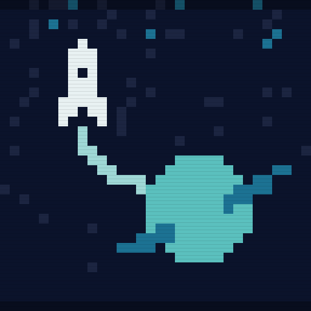 |

- **draft-0:** "Ringed-planet occlusion trick reads cleanly … [but] the flame polygon plunges into the disc with zero negative-space gap, so it reads as fused, not arcing."
- **draft-1:** "The ring path slashes straight through the planet circle … reads as a 'blocked/muted' prohibition icon … the rocket is a disconnected paper-airplane in the top-left corner."
- **draft-2:** "The darker teal patches inside the planet body read as craters/continents, not a ring … the exhaust trail fuses directly into the planet's silhouette."

The winner refines one variable per round, and the critic re-scores each round (regressions would be discarded):

| round 1 · **5/10** | round 2 · **6/10** | shipped (after the hand fix) |
| --- | --- | --- |
|  |  |  |

- **round 1** applied the required change — moving the rocket up-left so starfield separates flame from planet — and the critic promptly named the next flaw: "the ring is two axis-aligned rects, not an ellipse … reads as a belt/sash."
- **round 2** replaced the bar with a tilted ellipse annulus that genuinely passes behind then in front of the disc via clip-paths: "nails Saturn-style occlusion … a real three-tier value structure."
- **the closing fix** came from the critic's final note — the ring bled into the icon-safe margin — applied by hand as one more one-variable edit (outer ring 184×56 → 150×45). The loop hands off cleanly between agents and humans because every critique ends with exactly one actionable change.

Score trajectory: 5 → 5 → 6 with three concrete defects retired; "stingy scoring" is calibrated so 8+ means shippable-as-is.

## Stage 8 — finalize, promote, provenance

Before anything ships: `svg-check.py --strict` must pass (title/role, size budget, precision); the squint test must hold; and `svgo` output is only accepted if it *still* passes strict — in the run above the finalize agent found svgo's default preset strips `role="img"`/`<title>` and correctly kept the unoptimized file. Externally sourced pieces enter git only through `freesvg.py promote`, which lints, copies into `library/external/freesvg/`, and appends a provenance-carrying manifest entry.

## Reproduce everything

```bash
# variants (deterministic)
python3 tools/svg/banner-seed.py --slug hello-world --out docs/showcase/variants/banner-hello-world.svg
python3 tools/svg/examples/flowfield.py --seed 2 --palette moss --out docs/showcase/variants/flowfield-moss-2.svg
python3 tools/svg/examples/flowfield.py --seed 9 --palette moss --out docs/showcase/variants/flowfield-moss-9.svg
python3 tools/svg/examples/pixelquest.py --seed 7 --palette cyanic --out docs/showcase/variants/pixel-quest-cyanic-7.svg
python3 tools/svg/examples/pixelquest.py --seed 7 --palette moss --out docs/showcase/variants/pixel-quest-moss-7.svg
python3 tools/svg/examples/invaders.py --seed 3 --palette dusk --out docs/showcase/variants/invaders-dusk-3.svg

# a fresh forge run (needs an agent session; intermediates land in .sweep/forge/)
#   Workflow svg-forge with args: {brief: "...", out: "out.svg", drafts: 3, rounds: 2}
```

The forge-run intermediates are one-of-a-kind run artifacts (agent output is not seeded); they are committed here precisely because they cannot be regenerated.
