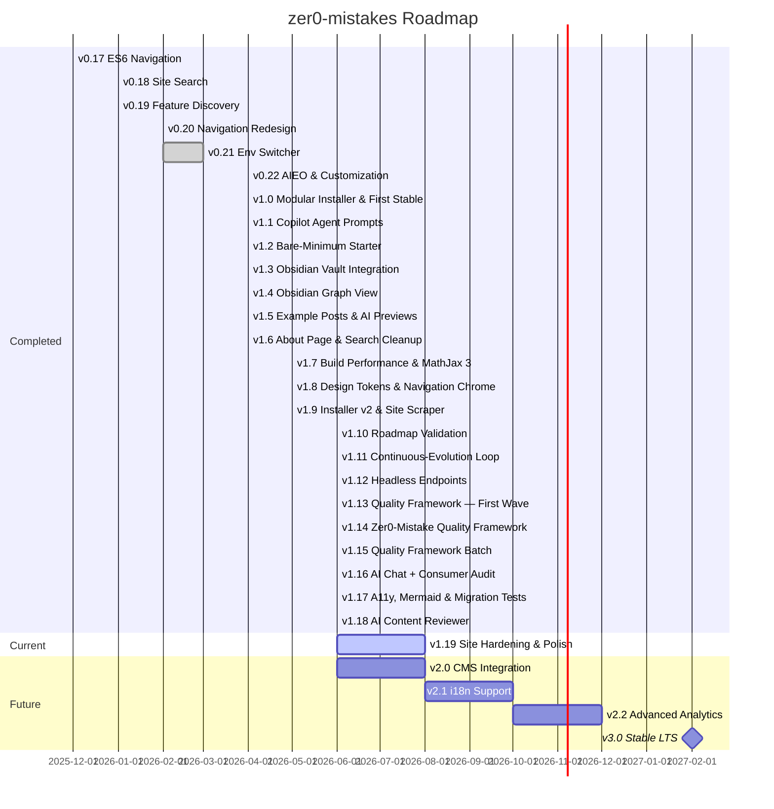

# zer0-mistakes

> A Jekyll theme that just works — blogs, docs, portfolios and project sites on GitHub Pages for $0 a month, Docker-first for local work, with first-class guidance for AI coding agents.

[](https://github.com/bamr87/zer0-mistakes/actions/workflows/pages/pages-build-deployment) [](https://badge.fury.io/rb/jekyll-theme-zer0) [](https://github.com/bamr87/zer0-mistakes/actions/workflows/ci.yml) [](LICENSE) [](https://zer0-mistakes.com/) [](https://github.com/bamr87/zer0-mistakes/blob/main/docker-compose.yml) [](https://getbootstrap.com/) [](AGENTS.md) [](https://zer0-mistakes.com/docs/seo/aieo/)

## 👋 Overview

`zer0-mistakes` is a ready-made website you can publish in minutes, with no design skills, no servers to manage, and almost nothing to install: pick a starting point, write your content in plain Markdown, and push to GitHub. The [live demo](https://zer0-mistakes.com/) is built with this exact theme, from this repository.

If you know Jekyll, Docker or AI coding agents, the same theme grows into a programmable platform: a self-healing installer and install CLI, generated preview images, guidance for Copilot, Cursor and Claude, and automated releases of the `jekyll-theme-zer0` gem. Beginners can skip all of it.

## ✨ Key Features

- 📝 **[Pages, posts and docs](https://zer0-mistakes.com/docs/jekyll/collections/)** — posts, docs, notes, notebooks, books and recipes, with tags and categories
- 🎨 **[Responsive Bootstrap 5.3 design](https://zer0-mistakes.com/docs/customization/styles/)** — design tokens, skins and a theme customizer
- 🌗 **[Light, dark and auto modes](https://zer0-mistakes.com/docs/features/color-modes/)** with a one-click toggle
- 🔍 **[Built-in site search](https://zer0-mistakes.com/docs/features/site-search/)** — press `/` or `Ctrl/Cmd+K` anywhere
- 🧭 **[Navigation](https://zer0-mistakes.com/docs/features/navigation-architecture/)** — sidebar, breadcrumbs, table of contents, keyboard shortcuts and swipe gestures
- 📊 **Diagrams and math** — Mermaid charts and MathJax equations out of the box ([Mermaid](https://zer0-mistakes.com/docs/features/mermaid-diagrams/), [math](https://zer0-mistakes.com/docs/features/mathjax-math/))
- 📓 **[Jupyter notebooks](https://zer0-mistakes.com/docs/features/jupyter-notebooks/)** rendered as pages
- 🧠 **[Obsidian-friendly](https://zer0-mistakes.com/docs/obsidian/)** — edit the site as a vault, `[[wiki-links]]`, embeds, callouts and backlinks included
- 🔒 **Privacy-first** — cookie consent, and PostHog analytics that load only after opt-in ([analytics](https://zer0-mistakes.com/docs/features/posthog-analytics/), [cookie consent](https://zer0-mistakes.com/docs/features/cookie-consent/))
- 💬 **Comments and feedback** — Giscus discussions, an "Improve this page" button that files labelled issues, and an opt-in AI chat assistant ([Giscus](https://zer0-mistakes.com/docs/features/giscus-comments/), [AI chat](https://zer0-mistakes.com/docs/features/ai-chat-assistant/))
- 🛠️ **Setup and admin** — an in-browser Site Builder at `/setup/` and admin pages for configuration, navigation and collections ([Site Builder](https://zer0-mistakes.com/docs/features/site-builder/), [admin pages](https://zer0-mistakes.com/docs/features/admin-dashboard/))
- 🖼️ **[Preview images](https://zer0-mistakes.com/docs/features/preview-image-generator/)** generated for posts that lack one
- 🤖 **[AIEO](https://zer0-mistakes.com/docs/seo/aieo/)** — JSON-LD structured data, a FAQ and a glossary so AI assistants cite your site accurately
- ⚙️ **[Free hosting on GitHub Pages](https://zer0-mistakes.com/docs/features/vendored-assets/)** — every third-party asset is vendored, so a Pages build needs no CDN and no npm

Full catalogue: the [feature index](https://zer0-mistakes.com/docs/features/) (registry: [`_data/features.yml`](_data/features.yml)).

## 🚀 Quick start

You only need a free [GitHub account](https://github.com/signup). Pick the path that matches your comfort level; every option, including the Ruby gem, is in the [quick-start guide](https://zer0-mistakes.com/docs/getting-started/quick-start/).

**Path A — fork it (no terminal).** [Fork the repository](https://github.com/bamr87/zer0-mistakes/fork), rename the fork to `<your-username>.github.io`, choose **Settings → Pages → Deploy from a branch → `main`**, and visit `https://<your-username>.github.io` a minute later. Edit `_config.yml` and any `*.md` file on GitHub to make it yours ([fork and deploy](https://zer0-mistakes.com/docs/quickstart/fork-and-deploy/)).

**Path B — three files (still no install).** The theme loads over the network as a remote theme:

```yaml
# _config.yml
title:        "My Site"
description:  "A site rendered by the zer0-mistakes remote theme."
remote_theme: bamr87/zer0-mistakes
plugins:
  - jekyll-remote-theme
  - jekyll-feed
  - jekyll-sitemap
  - jekyll-seo-tag
site_configured: false   # show the welcome wizard until you flip this to true
```

```ruby
# Gemfile
source "https://rubygems.org"
gem "github-pages", group: :jekyll_plugins
gem "jekyll-remote-theme"
gem "webrick", "~> 1.7"
```

```markdown
---
layout: welcome
title: Home
---

# Welcome to my site
```

Save the last block as `index.md` and push to a Pages-enabled repository. Until `site_configured: true`, the home page shows the **welcome layout** with an in-browser wizard that writes a personalised `_config.yml` for you ([bare-minimum starter](https://zer0-mistakes.com/docs/quickstart/bare-minimum/)).

**Path C — local development with Docker.** With [Docker Desktop](https://www.docker.com/products/docker-desktop) and [Git](https://git-scm.com/) installed, the self-healing installer detects your platform, sets up the site and recovers from common errors:

```bash
mkdir my-site && cd my-site && curl -fsSL https://raw.githubusercontent.com/bamr87/zer0-mistakes/main/install.sh | bash
docker-compose up   # then open http://localhost:4000
```

The modular CLI behind it (`./scripts/bin/install init|wizard|deploy|doctor|scrape …`, profiles, deploy targets, cloning an existing site) is documented in [docs/installation/](docs/installation/index.md) and the generated [installer reference](docs/reference/installer.md).

**Work on the theme itself** — from a clone of this repository:

```bash
bundle install && npm ci              # install the Ruby gems and the Node tooling (Playwright, vendor scripts)
docker-compose up                     # run: Jekyll with live reload at http://localhost:4000
./scripts/bin/test                    # test: lib + theme + integration tiers
./scripts/bin/validate --quick        # lint: host-only preflight (files, versions, YAML, config contract)
gem build jekyll-theme-zer0.gemspec   # build the gem
```

## 🏗 Architecture

Your Markdown and YAML flow through the theme's Liquid layouts and includes, are compiled by Jekyll 3 (through the `github-pages` gem), and publish as a static site any host can serve. Styles are Sass design tokens over Bootstrap 5.3.3, navigation is ES6 modules, and a few Jekyll plugins add the search index, sitemap and Obsidian links. `_config.yml` targets production with `remote_theme`; `_config_dev.yml` switches to the local theme files. Contributor detail: [project structure](docs/architecture/project-structure.md), [layouts and includes](docs/architecture/layouts-includes.md) and the [design system](docs/ui/design-system.md).

## 🚢 Deployment

| Target | Cost | How | Best for |
| --- | --- | --- | --- |
| **GitHub Pages user site** | Free | Push to `main` of `<username>.github.io` (Path A) | Personal sites, docs, blogs, portfolios |
| **Docker production image** | Self-hosted | `JEKYLL_ENV=production docker-compose up -d` | Self-hosted servers, intranets, air-gapped environments |
| **Any static host** | Varies | `docker-compose run --rm jekyll jekyll build`, then upload `_site/` | Netlify, Vercel, Cloudflare Pages, S3, Azure Static Web Apps |

Guides: [deployment](https://zer0-mistakes.com/docs/deployment/), [custom domain](https://zer0-mistakes.com/docs/deployment/custom-domain/).

## 📚 Documentation

- **User guides** — published at [zer0-mistakes.com/docs/](https://zer0-mistakes.com/docs/) from [`pages/_docs/`](pages/_docs/): installation, customization, features, deployment, troubleshooting.
- **Contributor docs** — [docs/README.md](docs/README.md) indexes every technical document in the repository: architecture, the installer, release automation, the UI reference, and the generated [command](docs/reference/commands.md), [workflow](docs/reference/workflows.md) and [agent-guidance](docs/reference/agent-guidance.md) references.
- **Agents and automation** — [`AGENTS.md`](AGENTS.md) first; [`.github/workflows/README.md`](.github/workflows/README.md) explains the CI, release and autonomous-pipeline workflows.

## 🗺 Roadmap

The diagram and table below are generated from [`_data/roadmap.yml`](_data/roadmap.yml) by [`scripts/generate-roadmap.rb`](scripts/generate-roadmap.rb). The [roadmap page](https://zer0-mistakes.com/roadmap/) has the per-version detail.

<!-- ROADMAP_MERMAID:START -->



<!-- ROADMAP_MERMAID:END -->

<!-- ROADMAP_TABLE:START -->

| Version | Status | Target | Highlights |
|---------|--------|--------|------------|
| **v0.17** | ✅ Completed | Dec 2025 | ES6 modular navigation with auto-hide navbar, hover dropdowns, keyboard navigation, and touch gestures. |
| **v0.18** | ✅ Completed | Jan 2026 | Client-side site search with a keyboard-shortcut search modal. |
| **v0.19** | ✅ Completed | Jan 2026 | 43 documented features with a comprehensive feature registry. |
| **v0.20** | ✅ Completed | Feb 2026 | Local Docker publishing pipeline and CI variable abstraction. |
| **v0.21** | ✅ Completed | Feb 2026 | Environment switcher, settings modal redesign, and RubyGems API-key auth. |
| **v0.22** | ✅ Completed | Apr 2026 | AI Engine Optimization (AIEO), structured data, and visual customization tools. |
| **v1.0** | ✅ Completed | Apr 2026 | First stable major release — the monolithic installer rewritten as a modular, spec-driven CLI. |
| **v1.1** | ✅ Completed | Apr 2026 | Data-driven Copilot Agent prompt registry focused on frontend and CMS workflows. |
| **v1.2** | ✅ Completed | Apr 2026 | Three-file remote-theme starter with an in-browser configuration wizard. |
| **v1.3** | ✅ Completed | Apr 2026 | Edit content as an Obsidian vault with identical rendering on GitHub Pages. |
| **v1.4** | ✅ Completed | Apr 2026 | Force-directed knowledge graph mirroring Obsidian's local graph view. |
| **v1.5** | ✅ Completed | Apr 2026 | Richer sample content and regenerated AI preview images. |
| **v1.6** | ✅ Completed | Apr 2026 | Expanded About page and removal of the Algolia search dependency. |
| **v1.7** | ✅ Completed | May 2026 | Significant Jekyll build speedups and a MathJax 3 inline-math fix. |
| **v1.8** | ✅ Completed | May 2026 | Sass design-token system, refreshed navigation chrome, and a docs overhaul. |
| **v1.9** | ✅ Completed | May 2026 | Modular installer v2 with deploy plugins, AI wizard pipeline, and a site scraper. |
| **v1.10** | ✅ Completed | Jun 2026 | Roadmap integrity validation and catch-up milestones so the roadmap tracks the shipped gem. |
| **v1.11** | ✅ Completed | Jun 2026 | Self-sustaining backlog loop so AI agents keep improving the repo between human sessions. |
| **v1.12** | ✅ Completed | Jun 2026 | Machine-readable site endpoints for downstream sites and AI agents. |
| **v1.13** | ✅ Completed | Jun 2026 | First shipped wave of the Zer0-Mistake Quality Framework: CI gate parity and DOM sanitization. |
| **v1.14** | ✅ Completed | Jun 2026 | Second wave of the Zer0-Mistake Quality Framework: DOM sanitization hardening and workflow lint cleanup. |
| **v1.15** | ✅ Completed | Jun 2026 | Quality framework batch: docs lint baseline, locale guard, strict site_generation, contribution templates, and YAML export fix. |
| **v1.16** | ✅ Completed | Jun 2026 | AI chat widget (ZER0-060) and consumer audit tooling; render guard bug fixed. |
| **v1.17** | ✅ Completed | Jun 2026 | Plugin unit specs, coverage baseline, config-page sync, WCAG 2.1 AA fixes, Mermaid on 12 more pages, and migration tests. |
| **v1.18** | ✅ Completed | Jun 2026 | Two-tier AI content reviewer framework and chat GitHub action tools (issue/PR creation via Claude tool use). |
| **v1.19** | 🚧 In Progress | Current (1.19.x) | Production config hardening, analytics privacy fix, landing-page opt-out flags, and a documentation freshness sweep. |
| **v2.0** | 🗓 Planned | Q3 2026 | Headless CMS integration with a content API and admin dashboard. |
| **v2.1** | 🗓 Planned | Q4 2026 | Multi-language content support with locale-aware routing. |
| **v2.2** | 🗓 Planned | Q4 2026 | Visual theme customizer, A/B testing, and conversion funnels. |
| **v3.0** | 🎯 Milestone | Q1 2027 | Stable public API, 90%+ test coverage, and long-term support commitment. |

<!-- ROADMAP_TABLE:END -->

## 📁 Project structure

If you only edit content, you will spend your time in `pages/` and `_data/`.

| Path | What lives there |
| --- | --- |
| `_layouts/`, `_includes/`, `_sass/`, `_plugins/` | The theme: page templates, reusable components, styles and design tokens, Jekyll plugins |
| `assets/` | JavaScript modules, the stylesheet entry, images, and `vendor/` (Bootstrap, Bootstrap Icons, Mermaid, MathJax) |
| `_data/` | Site data: navigation, homepage copy (`landing.yml`), UI strings, the feature registry, backlog and roadmap |
| `pages/` | Content collections — `_posts`, `_docs` (the user guides), `_about`, `_notes`, `_notebooks`, `_quickstart`, `_books`, `_recipes` |
| `fr/` | Generated French translations of the site |
| `docs/` | Contributor documentation (not published on the site) |
| `scripts/`, `install.sh` | Automation: `scripts/bin/` entry points, the installer, generators |
| `test/` | Theme test suites and Playwright specs |
| `templates/` | Installer profiles and deploy targets, admin pages, the consumer kit, the AI chat proxy |
| `lib/`, `jekyll-theme-zer0.gemspec` | The Ruby gem |
| `examples/` | Self-contained demo sites |

This `README.md` is also the site's homepage; its hero and feature cards come from `_data/landing.yml`.

## 🛠️ Development

The commands are in [Quick start](#-quick-start); every entry point, test suite, Make target, Rake task and npm script is in the generated [command reference](docs/reference/commands.md). A layout, include or Sass change needs a passing Jekyll build, and a visible change needs a regression test and before/after screenshots. [`AGENTS.md`](AGENTS.md) is the canonical guide for humans and agents: layout, conventions, generated files and invariants.

Releases are automated: release-please turns Conventional Commits on `main` into a release pull request, and merging it tags the version and publishes the gem to [RubyGems](https://rubygems.org/gems/jekyll-theme-zer0) ([release automation](docs/systems/release-automation.md)).

## 🤝 Contributing

Contributions of every size are welcome. Read [CONTRIBUTING.md](CONTRIBUTING.md) and the [code of conduct](CODE_OF_CONDUCT.md); agents start at [AGENTS.md](AGENTS.md). The short version:

```bash
gh repo fork bamr87/zer0-mistakes --clone && cd zer0-mistakes
git checkout -b feature/awesome-feature
docker-compose up        # iterate locally
./scripts/bin/test       # verify
git push origin feature/awesome-feature
```

Questions go to [GitHub Discussions](https://github.com/bamr87/zer0-mistakes/discussions), bugs to [GitHub Issues](https://github.com/bamr87/zer0-mistakes/issues), and security reports follow [SECURITY.md](SECURITY.md).

## 📝 Changelog

[CHANGELOG.md](CHANGELOG.md) records every release; tagged versions are on the [releases page](https://github.com/bamr87/zer0-mistakes/releases) and [RubyGems](https://rubygems.org/gems/jekyll-theme-zer0).

## 📄 License

MIT — see [LICENSE](LICENSE). Built with [Jekyll](https://jekyllrb.com/), [Bootstrap](https://getbootstrap.com/), [Docker](https://docker.com/), [PostHog](https://posthog.com/) and [Mermaid](https://mermaid.js.org/).

---

<!-- bamr87-portfolio-footer -->
Part of the [bamr87 portfolio](https://github.com/bamr87) — browse every project on [Amr's GitHub profile](https://github.com/bamr87).
