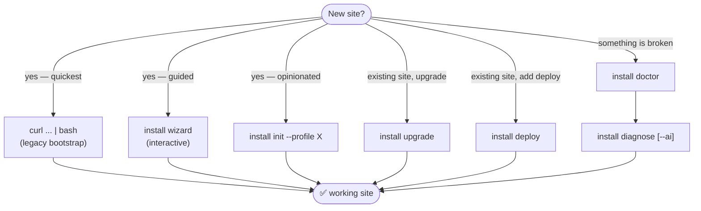

# Installation Guide

The `zer0-mistakes` installer is a modular, profile-driven, AI-aware CLI built around the canonical entrypoint [`scripts/bin/install`](../../scripts/bin/install). The classic `install.sh` one-liner still works — it now bootstraps the same modular pipeline.

## Pick your path



## Subcommand reference

Every subcommand, global option and example, as `./scripts/bin/install help` prints it, is in the generated [installer reference](../reference/installer.md).

## Clone an existing site (`--scrape`)

`install init <dir> --scrape <URL>` crawls an existing website breadth-first and turns it into a rendered zer0-mistakes site, with no post-processing; `install scrape <URL>` only crawls, into `./.zer0/scrape`. It needs `python3` (stdlib) and `curl` — no `pip` packages and no API key.

| What gets scraped | Where it lands |
|---|---|
| Home page | `index.md` with `permalink: /` |
| Event pages | `pages/events/<slug>.md` |
| Blog and news posts | `pages/news/<slug>.md` |
| All other pages | `pages/<slug>.md` |
| Images | `assets/scraped/<md5>.<ext>`, with the Markdown rewritten to the local paths |
| Navigation | `_data/navigation/main.yml` (junk labels such as Back, Cart and Folder: are filtered) |
| Site metadata | `_config.yml` title, description, lang and logo, seeded from the `<og:>` tags |

```bash
./scripts/bin/install init ./my-clone --scrape https://example.com                                         # depth 2, at most 25 pages
./scripts/bin/install init ./my-clone --scrape https://example.com --scrape-depth 3 --scrape-max-pages 50   # a deeper crawl
```

## What's where

| Topic | Doc |
|---|---|
| Bootstrap → CLI → libs → profiles → deploy modules | [`architecture.md`](./architecture.md) |
| Schema for `templates/profiles/*.yml` and how to author your own | [`profiles.md`](./profiles.md) |
| Per-target setup, prereqs, troubleshooting | [`deploy-targets.md`](./deploy-targets.md) |
| What AI does, what data is sent, how to disable, cost notes | [`ai-features.md`](./ai-features.md) |
| Flag-by-flag mapping from 0.x to 1.0 | [`migration-from-0.x.md`](./migration-from-0.x.md) |
| Overriding templates, custom profiles, custom deploy modules | [`customization.md`](./customization.md) |
| Fork → configure → personalize, and the workflows a fork inherits | [`forking.md`](./forking.md) |
| `url` and `baseurl` for user sites, project sites and custom domains | [`url-configuration.md`](./url-configuration.md) |

## Two-minute start

```bash
mkdir my-site && cd my-site
curl -fsSL https://raw.githubusercontent.com/bamr87/zer0-mistakes/main/install.sh | bash
docker-compose up   # http://localhost:4000
```

For local development against the repo:

```bash
git clone https://github.com/bamr87/zer0-mistakes.git
cd zer0-mistakes
./scripts/bin/install help
./scripts/bin/install doctor
```

---

**Last updated:** 2026-04-20 — Phase 7 docs refresh (1.0.0 prep).

---

> **User guide**: For theme end users, the quick-start paths are at [Quick Start Guide](/docs/getting-started/quick-start/) in the user documentation.
